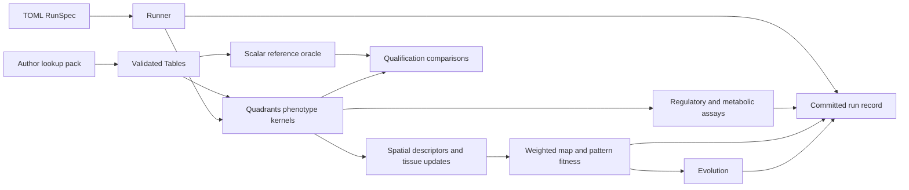

# Architecture and execution path

toyLIFE2 has one canonical rule set, `toylife-canonical-v1`. A strict TOML
specification selects an operation and records all scientific inputs. The
implementation separates a scalar chemistry reference, batched Quadrants
phenotype kernels, spatial compilation, evolutionary selection, and immutable
run records. [Model rules](model.md) and [source decisions](decisions.md)
describe the scientific choices; this guide describes how a run executes.

## Scientific inputs and identity

`RunSpec` validates operation, model, assay, tissue, evolution, cell, map,
execution, and recording fields. Unknown fields fail validation. A seed is
required for sampled genotypes and all evolutionary workflows. A record saves
the fully expanded spec, a rule-set identifier, the exact molecular lookup
pack, package source and dependency information, and any external target file.
Scientific identity includes the target file hash and all scientific fields;
hardware placement, batch size, memory budget, and recording detail are
separate execution fields. The actual backend is recorded after execution.

## Molecular model and kernels

`Tables` loads the author lookup files from the checkout or bundled wheel,
validates their structure, and exposes read-only arrays. Source energies become
integer tenths, so binding thresholds and equal-strength competition use exact
comparisons. The curated dimer assembly and ligand tables keep the author's
discrete geometry decisions; independent regeneration checks folds, contact
energies, and the three source-pinned polymerase annotations.

`ReferenceModel` implements one genotype and cell state at a time, including
promoter snapshots, reaction phases, metabolite fission, and cycle detection.
`Engine` keeps tables resident in Quadrants arrays and evaluates batches. The
small regulatory truth tables use the batched chemistry kernel. For larger
genomes, the assay follows regulatory states reachable from all-off, detects
the repeating phase, and tests metabolic chemistry across those phases.
Regulatory, metabolic, and cell outputs carry completion status when a cap is
reached.

## Tissue and complete map

A two-gene genotype becomes a six-input response descriptor plus an AB
availability bit. The default local cellular automaton has 64 radius-one
entries. Spatial execution advances all cells synchronously; free A, free B,
and preformed AB are distinct chemical inputs. Continuous or explicit
injections can add free molecules to a cell containing AB, so these schedules
use an extended 216-entry input rule. Open boundaries supply zero outside the
line, while ring boundaries wrap.

The weighted map walks the 2,711 × 2,711 ordered protein pairs. Each pair
evaluates sixteen promoters per gene and weights the 256 promoter combinations
by the number of coding sequences that produce each protein. A complete map
therefore represents all `2**40` two-gene genomes. It accumulates exact integer
histograms for six-output logic, seven-symbol GRNs, cellular automata, and
tissue patterns. The map evaluates a trajectory once per distinct local rule
and protocol. Pattern IDs hash the protocol and trajectory bytes, so a pattern
ID is stable within this implementation's declared protocol.

`map.start_pair` and `map.stop_pair` choose adjacent, independently mergeable
pair intervals; `map.tile_pairs` defaults to 64. The map records a cursor and
histograms at tile checkpoints. `execution.max_tiles` can intentionally stop
an invocation at a partial, resumable result. `merge_map_shards` checks
adjacency, shared table and spatial identity, and conservation of genotype
multiplicity. The full-map qualification gate is described in
[qualification.md](qualification.md).

## Records and recovery

The runner writes a manifest-backed record under a standalone destination or
workspace. Workspace packs share immutable table bytes by content hash. Result
arrays are `.npy` files; summaries and bounded event traces remain readable
without rerunning the model. A checkpoint is first written as a new immutable
revision and then committed by an atomic manifest replacement. The latest two
committed revisions remain; an orphan left by a crash does not change the
resume point. A resumed or reproduced record links to its parent manifest and
checkpoint hash. `reproduce` verifies source, table pack, numerical dependency
identity, and original integrity before executing and comparing results.

`profile` records cold and warm synchronized calls with the actual backend;
`qualify` compares selected kernel results to the scalar oracle and regenerates
geometry. The [record guide](records.md), [CLI guide](cli.md), and
[performance guide](performance.md) give commands and artifact details.

## Persistent sessions

Schema 2 adds a common session lifecycle beneath the CLI and Python API.
`BatchRunner` shares one Model/Engine and table pack across sessions. Chemistry
compiles each admitted molecular vocabulary into padded species/reaction arrays,
with persistent device buffers and simultaneous phase decisions. `TissueSession`
uses the compiled local rule for incremental synchronous updates. `RolloutSession`
owns a committed world and a separate pending decision containing encoded inputs,
chemical progress, codec state, prepared actions and messages.

The evaluator preserves candidate order, separates validity from fitness, caches
complete pure results, and retains unfinished episode cohorts. Population sessions
score ready replicate lanes together, then advance each independently. Contextual
games freeze the roster and require a complete scoring barrier. External sessions
retain one ask request and restore post-ask numerical optimizer state when tell or
its commit fails. Named batches coalesce compatible fixed assays and advance live
sessions fairly; child manifests remain independent durable commit points.

The [runner guide](runner.md) specifies batch axes, logical work quotas, readouts,
source-aware callbacks and continuation APIs. Live session numerical buffers are
admitted against the runner budget. Graph metadata, Python interpreter memory and
compiler caches are outside that numerical buffer estimate. World kernels operate
on NumPy state at decision boundaries, so Metal includes those transfers.
